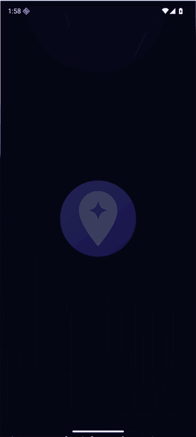

<p align="center">
  
</p>

<h1 align="center">Altrove</h1>

<p align="center">
  <em>Be somewhere else, five minutes at a time.</em><br>
  An Android home-screen widget that moves your GPS position to a spot you choose
  for exactly five minutes, then puts the real one back on its own.
</p>

<p align="center">
  <a href="https://github.com/Perruzz/Altrove/releases/latest/download/Altrove.apk"><strong>⬇ Download Altrove.apk</strong></a>
</p>

<p align="center">
  
</p>

<p align="center">
  
  
</p>

*Altrove* is Italian for *elsewhere*.

## What it does

- **The widget** is the switch. Tap it and, for the next five minutes, every app on the phone
  that asks where you are gets the saved coordinates: open Google Maps and the blue dot is
  there. Nothing is blocked or paused, the phone just believes it is elsewhere.
- **After five minutes** the real GPS comes back by itself. Tap the widget again to end
  earlier.
- **The app** is where you choose the destination: type latitude and longitude, paste a pair
  copied from Google Maps, or tap the globe to pick a place.

## The look

Opening the app is a small trip through space.

- **Arrival.** You drop out of warp speed: the stars stretch into streaks and slow down while
  the Earth, drawn as a sphere of dots, swings round to face your destination.
- **Choosing.** The globe follows what you type, with a reticle on the place you are about to
  pick. Tap it to choose a spot, drag it sideways to spin it.
- **Saving** sends a shock wave across the globe from the new beacon.
- **Start** jumps to warp again: the sky turns magenta, a ring around the Earth runs down
  with the five minutes and the countdown digits roll over one by one.

The widget wears the same night sky, indigo at rest and magenta during a session. A
notification shows the countdown with a Stop button; on recent Android versions it also sits
in the status bar. With animations turned off in Android's accessibility settings, the scene
stays still. The interface is in English and Italian.

<p align="center">
  
  
</p>

## Download

**[Altrove.apk](https://github.com/Perruzz/Altrove/releases/latest/download/Altrove.apk)**
(about 1.3 MB), always the latest version. Older builds are on the
[releases page](https://github.com/Perruzz/Altrove/releases).

Requires Android 8.0 or later. It is developed and tested on a Pixel 8a with Android 17 and on
an Android 16 emulator; older versions are supported by the code but untested.

Open the file on the phone to install it. Android will ask you to allow installs from the app
you opened it with (browser or file manager): that is expected for apps from outside the Play
Store. Updating from an earlier version keeps your destination and your setup.

## Setup

Done once, in the app, which walks you through it.

1. **Pick Altrove as the mock location app.** Android only lets one app, chosen by you in
   *Developer options*, replace the device position. Tap **Open Developer options** in the
   app, then **Select mock location app → Altrove**.
   If the phone has no Developer options yet, enable them first: *Settings → About phone*,
   tap *Build number* seven times.
2. **Optional permissions.** *Notifications* show the countdown. *Location* lets Google Play
   services hold the spot steadily in Google's own apps (see [How it works](#how-it-works));
   Altrove itself never reads your real position.
3. **Add the widget.** Tap **Add the widget to the home screen** in the app, or long-press the
   home screen and pick it from the widget list.

## Use

1. Open Altrove and choose the destination: type latitude and longitude in decimal degrees
   (for example `41.8902` and `12.4922`), paste a pair like `41.8902, 12.4922` into either
   field, or tap the globe. Then tap **Save**.
2. Tap the widget. You are there for five minutes.
3. Tap it again to come back early, or let the timer run out.

Saving new coordinates during a session moves you there at once, without resetting the timer.

## How it works

Altrove uses the mock-location API that Android provides for testing, nothing hidden and no
root.

- Tapping the widget starts a foreground service. It replaces the `gps`, `network` and `fused`
  location providers with test providers and reports the saved coordinates on each of them
  once a second.
- If the location permission was granted, it also puts Google Play services' fused provider
  in mock mode. Without this, Play services may blend the mocked GPS with real Wi-Fi and cell
  fixes, and apps that rely on it can drift back to where you really are.
- Five minutes later, to the second, it removes the test providers and stops. A wake lock
  keeps the timer exact with the screen off (measured on a Pixel 8a: 299.98 s).
- If the app dies mid-session, the leftovers are removed as soon as it runs again, so the real
  GPS never stays switched off. Android restarts it by itself after a crash.

The app has no internet permission: it cannot send anything anywhere. The globe is drawn on
the phone from a small map of the continents built into the app.

## Good to know

- **Apps can tell.** Android marks every mocked position as mocked, and that flag cannot be
  removed without root. Maps, weather and most apps ignore it, but apps that check it (some
  banking apps and games, for instance) will know.
- **Force stop.** If you force-stop Altrove from Android's settings during a session, tap the
  widget or open the app once: that restores the real GPS.
- **One mock app at a time.** Choosing another mock location app in Developer options turns
  Altrove off until you select it again.

## Build from source

Needs JDK 17 or newer and the Android SDK (platform 37).

```bash
git clone https://github.com/Perruzz/Altrove.git
```

```bash
cd Altrove && ./gradlew assembleRelease
```

The APK lands in `app/build/outputs/apk/release/`. Without signing configuration it is signed
with the debug key, which is fine for your own phone. To use your own key, create
`keystore.properties` in the project root (it is git-ignored):

```properties
storeFile=path/to/your.jks
storePassword=...
keyAlias=...
keyPassword=...
```

The code is Kotlin: Jetpack Compose for the app screen, a classic `RemoteViews` widget, and
one foreground service. The sources live in `app/src/main/java/app/Altrove`, while the Kotlin
package stays `app.altrove`, lowercase as Android expects. Good places to start:

- [`MockLocationService.kt`](app/src/main/java/app/Altrove/MockLocationService.kt) and
  [`LocationMocker.kt`](app/src/main/java/app/Altrove/LocationMocker.kt): the session and the
  mock providers.
- [`ui/MainScreen.kt`](app/src/main/java/app/Altrove/ui/MainScreen.kt) and
  [`ui/space/`](app/src/main/java/app/Altrove/ui/space): the screen, the starfield and the
  globe, simulated by hand once per frame.

The continents of the globe are a one-degree land mask generated from hand-traced coastlines
by [`tools/earth_mask.py`](tools/earth_mask.py) (Python, with Pillow and numpy). Run it again
after editing an outline; `--preview DIR` also renders a few views of the globe.
